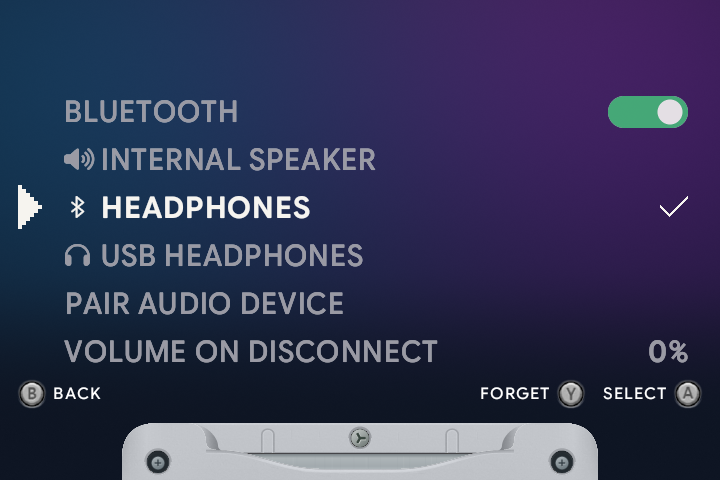

# 🎧 Audio & headphones

[← Overview](README.md) · [All guides](GUIDE.md)

[Outputs](#choose-an-output) · [Bluetooth](#pair-bluetooth-headphones) · [Volume](#volume--mute) · [Disconnect volume](#volume-on-disconnect)

## Choose an output

Open **Menu → Sound** from the carousel, or **Menu → Settings → Sound** during play. The selected output has a checkmark.

| Output | How to use it |
| :--- | :--- |
| **Internal speaker** | Select it in Sound. |
| **Wired headphones** | Plug into the headphone jack. The local output changes from Internal speaker to Wired headphones. |
| **Bluetooth headphones** | Pair once, then select them by name in Sound. |
| **USB audio** | Plug into the data/OTG port. A detected playback device is selected automatically and appears by name in Sound. |

The status and volume icons show the current audio output. A manual output choice stays selected until another USB attachment or restart.

## Pair Bluetooth headphones

1. Put your headphones in pairing mode.
2. Open **Sound → Pair audio device**. This enables Bluetooth if it is off.
3. Choose **Scan for devices**.
4. Select your headphones with the D-pad and press <kbd>A</kbd>.
5. Once connected, adjust the volume with the handheld's volume buttons.

Saved headphones appear by name on the main Sound screen. Select a device and press <kbd>A</kbd> to reconnect. The selected Bluetooth device reconnects automatically at startup and after a connection is lost while the handheld is awake.

### Switch back or turn Bluetooth off

Select **Internal speaker** or **Wired headphones** to return to local audio. This also stops automatic reconnect to the Bluetooth device.

The **Bluetooth** switch is the first row in Sound. Green means on; gray means off. Press <kbd>A</kbd> or use <kbd>Left</kbd> / <kbd>Right</kbd> to change it. Turning it off keeps your saved pairings. The choice is remembered.

If an operation fails, Sound shows **Error**, restarts Bluetooth and tries the operation once more.

### Forget a device

Highlight the saved device, press <kbd>Y</kbd>, release it and press <kbd>Y</kbd> again to confirm. <kbd>B</kbd> or moving to another row cancels.

## Volume & mute

| Button | Action |
| :--- | :--- |
| <kbd>VOL+</kbd> / <kbd>VOL−</kbd> | Change the active output's volume. |
| Both volume buttons together | Toggle mute. |
| <kbd>SELECT</kbd> + either volume button | Toggle mute. |

The speaker, wired headphones, Bluetooth and USB each remember their own volume and mute state. USB audio starts at **20%**.

A speaker-with-X icon stays at the top of the carousel and menus while the active output is muted or its volume is zero. It appears beside the Bluetooth or headphones indicator, so both the connection and mute state remain visible.

Headphones with their own volume controls may also need those controls adjusted. Use the handheld's volume indicator to set slot.sp's level.

In kid mode, volume stays within the parent's [volume limit](KID-MODE.md#time--volume-limits). The kid menu also has a Volume row.

## Volume on disconnect

In Sound, set **Volume on disconnect** to choose the volume used after Bluetooth disconnects or headphones are unplugged. It starts at **0%** and changes in **5%** steps.

If wired headphones are plugged in when Bluetooth disconnects, the chosen level applies to those headphones. Otherwise it applies to the speaker.

<strong>Sound menu buttons</strong>

| Button | Action |
| :--- | :--- |
| <kbd>Up</kbd> / <kbd>Down</kbd> | Choose an output or setting. |
| <kbd>Left</kbd> / <kbd>Right</kbd> | Change a value, such as Bluetooth On/Off or disconnect volume. |
| <kbd>A</kbd> | Select, connect or start a scan. |
| <kbd>Y</kbd> | Begin forgetting a saved device. |
| <kbd>B</kbd> | Go back. |
| <kbd>MENU</kbd> | Close Sound. |

---

[Buttons & shortcuts](CONTROLS.md) · [Kid mode](KID-MODE.md) · [Sleep & power](POWER-OPTIONS.md)

## Pause on disconnect

**Sound → Pause on disconnect** optionally pauses the game when the active wired headphones, Bluetooth device, or USB audio device disconnects. It is off by default. The normal pause menu opens; reconnecting does not resume the game automatically. Kid mode opens its existing child menu.

Intentional output changes do not trigger this pause, and link play keeps running so the other player is not interrupted. The separate **Volume on disconnect** setting still applies. Both choices are saved in `Config/sound.conf`.
