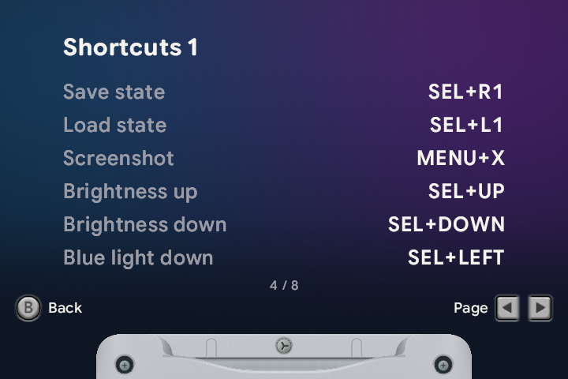

# 🕹️ Buttons & shortcuts

[← Overview](README.md) · [All guides](GUIDE.md)

[Carousel](#on-the-carousel) · [In game](#in-game) · [Display & volume](#display--volume) · [Remapping](#change-a-button)

These are the default controls. Press a shortcut's buttons together, then release them. Hold a button only where the instructions say to. In kid mode, use the [kid menu](KID-MODE.md#the-kid-menu) for the available settings.

## On the carousel

| Button | Action |
| :--- | :--- |
| <kbd>Left</kbd> / <kbd>Right</kbd> | Choose a game. |
| <kbd>Up</kbd> / <kbd>Down</kbd> | Jump to the previous or next starting letter. |
| <kbd>L1</kbd> / <kbd>R1</kbd> | Switch between systems, Favorites and Recents. |
| Tap <kbd>A</kbd> | Launch the selected game and load its resume state when enabled. |
| Hold <kbd>A</kbd> | Launch from the game's title screen, without loading a resume state. |
| <kbd>Y</kbd> | Add to Favorites; press again to begin removing a favorite. |
| <kbd>X</kbd> | Approve for kid mode; press again to begin removing approval. |
| <kbd>START</kbd> | Choose the emulator for a GBA game. |
| <kbd>MENU</kbd> | Open settings. |

To confirm removal of a favorite or kid approval, release the button and press it again within three seconds. Moving away cancels it.

## In game

| Button | Action |
| :--- | :--- |
| Tap <kbd>MENU</kbd> | Open the game menu. |
| Hold <kbd>MENU</kbd> | Save on exit when enabled, then return to the carousel. |
| Double-tap <kbd>MENU</kbd> | Open the save-state browser. |
| <kbd>SELECT</kbd> + <kbd>R1</kbd> | Save a state. |
| <kbd>SELECT</kbd> + <kbd>L1</kbd> | Load the newest state. |
| <kbd>MENU</kbd> + <kbd>X</kbd> together | Take a screenshot; release both buttons afterward. |
| Hold <kbd>R2</kbd> | Fast-forward. |
| Double-tap <kbd>R2</kbd> | Keep fast-forward on; press it again to stop. |
| Hold <kbd>L2</kbd> | Rewind. |
| Hold <kbd>X</kbd> / <kbd>Y</kbd> | Turbo A / Turbo B. |
| <kbd>SELECT</kbd> + <kbd>MENU</kbd> | Open link play. |
| <kbd>L1</kbd> / <kbd>R1</kbd> in GB or GBC games | Previous / next scaling mode: Actual, Stretch, Fit and Integer. |

## Display & volume

| Button | Action |
| :--- | :--- |
| <kbd>SELECT</kbd> + <kbd>X</kbd> | Switch day/night display presets. |
| <kbd>SELECT</kbd> + <kbd>Up</kbd> / <kbd>Down</kbd> | Raise / lower brightness. |
| <kbd>SELECT</kbd> + <kbd>Left</kbd> / <kbd>Right</kbd> | Reduce / increase warmth. |
| <kbd>VOL+</kbd> / <kbd>VOL−</kbd> | Raise / lower the current output's volume. |
| <kbd>VOL+</kbd> + <kbd>VOL−</kbd> | Toggle mute. |
| <kbd>SELECT</kbd> + either volume button | Toggle mute. |
| <kbd>SELECT</kbd> + <kbd>A</kbd> / <kbd>B</kbd>, in game | Next / previous shader. |
| <kbd>SELECT</kbd> + <kbd>Y</kbd>, in game | Toggle color correction. |
| <kbd>SELECT</kbd> + <kbd>L2</kbd> / <kbd>R2</kbd>, in GB games | Previous / next palette. |

## In menus

| Button | Action |
| :--- | :--- |
| <kbd>Up</kbd> / <kbd>Down</kbd> | Choose a row. |
| <kbd>Left</kbd> / <kbd>Right</kbd> | Change its value. |
| <kbd>A</kbd> | Open or select. |
| <kbd>B</kbd> | Go back. |
| <kbd>MENU</kbd> | Close the menu. |

Follow the on-screen hints for a confirmation or a screen with different controls, such as parent-code entry.

## On-device reference

Open **Menu → Controls → Buttons & Shortcuts**, or during a game **Menu → Settings → Buttons & Shortcuts**. Use **Left / Right** to change pages and **B** to return. It shows your saved button mappings, including remapped or unbound shortcuts.

Kid mode has its own **Buttons & shortcuts** row in the kid menu. Its guide covers choosing and leaving games, safe menu controls and mapped game buttons. It leaves out shortcuts that kid mode blocks and never unlocks parent settings.

## Change a button

Open **Menu → Controls**, then choose a page:

| Page | What it changes |
| :--- | :--- |
| **Shelf** | Carousel switching and the Favorite button. |
| **Shortcuts** | Save/load, screenshots, display shortcuts, day/night, fast-forward and rewind. |
| **In-Game** | Game buttons and turbo buttons. Also available through in-game **Settings → Controls**. |

1. Highlight the action and press <kbd>A</kbd>.
2. When **Recording** appears, press the button or combination you want.
3. The new binding appears on that row and saves immediately.

On a controls page, <kbd>X</kbd> clears a binding. <kbd>Y</kbd> offers to restore that page's defaults; <kbd>A</kbd> confirms the reset.

Shortcuts and carousel bindings accept single buttons or two-button combinations. Game bindings accept a single button or <kbd>MENU</kbd> plus a button. <kbd>SELECT</kbd>, <kbd>START</kbd> and <kbd>MENU</kbd> act as the first button of a combination.

---

[Playing & saving](PLAYING.md) · [Day & night](NIGHT-DISPLAY.md) · [Kid mode](KID-MODE.md)
