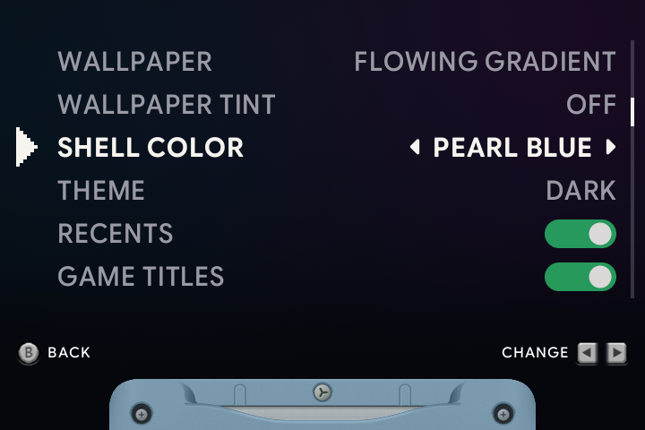
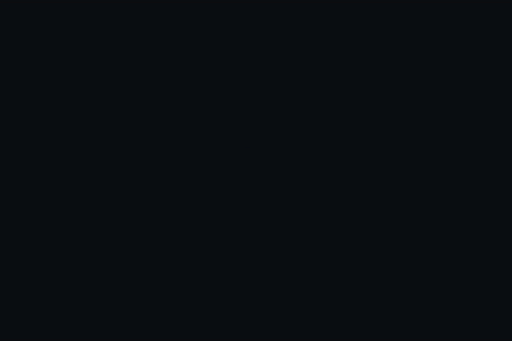

# 🎨 Appearance & screen

[← Overview](README.md) · [All guides](GUIDE.md)

[Colors](#colors) · [Backgrounds & animation](#backgrounds--animation) · [Game picture](#the-game-picture) · [Your own artwork](#your-own-backgrounds--borders)

## Type

Google Sans Flex is used across menus, cartridge captions, notices and settings. Selected rows gain weight and a little width. Headings use rounder letterforms, while hints and small text use an optical size chosen for readability. Numeric values use equal-width digits so changing a clock or percentage does not make the text jump.

The About sticker credits the typeface alongside the artwork and symbols.

## Colors

Open **Menu → General → Shell Color** to choose the SP artwork's color:

| Choice | Appearance |
| :--- | :--- |
| **Graphite** | Dark gray. |
| **Platinum** | Silver. |
| **Pearl Blue** | Blue. |
| **Pearl Pink** | Pink. |
| **Theme** | Graphite with the dark theme; Platinum with the light theme. |

The selected color also appears on the animated power switch and link screen. **General → UI theme** chooses Dark or Light. Light uses pale cards and dark text across settings, status, prompts and feedback.

## Backgrounds & animation

Open **Menu → General**:

| Setting | What to choose |
| :--- | :--- |
| **Wallpaper** | Flowing Gradient, Static Gradient, None, Random, or one of your own images. |
| **Wallpaper Tint** | Darken a custom or random background so the games stand out. |
| **Boot Animation** | Show or skip the slot.sp logo animation at startup. |
| **Carousel Sounds** | Play or silence the soft clicks when moving between games. |
| **Game Titles** | Choose Off, Clean names without tags, or the full Filename above the slot. |

**Flowing Gradient** slowly moves through teal and purple. **Static Gradient** keeps a still background. **Random** chooses one of your wallpaper images at startup. Light UI uses pale mint, sky and lavender for the flowing gradient, a matching light static gradient, and a plain light surface with wallpaper off. Custom and random wallpapers receive a soft light palette too; Wallpaper Tint adds a light veil instead of darkening them. Returning to Dark restores their original colours.

## The game picture

Open **Menu → Screen**, then choose **Game Boy Advance**, **Game Boy Color** or **Game Boy**. During a game, use **Menu → Settings → Screen** for the current system.

| Setting | What it changes |
| :--- | :--- |
| **Shader** | The screen effect: LCD3x, grid, dots or a simpler texture, depending on the system. |
| **Color Correction** | Adjust colors toward the original handheld's display. |
| **Palette** | Choose the colors for original Game Boy games. |
| **Bezel** | Choose the border around the game picture. |

Each system remembers its own settings. Game Boy palettes include **Auto**, grayscale, DMG Green, GB Pocket, GB Light, Game Boy Color presets and Super Game Boy palettes.

### Picture shortcuts

| Button | Action |
| :--- | :--- |
| <kbd>SELECT</kbd> + <kbd>A</kbd> / <kbd>B</kbd> | Next / previous shader. |
| <kbd>SELECT</kbd> + <kbd>Y</kbd> | Toggle color correction. |
| <kbd>SELECT</kbd> + <kbd>L2</kbd> / <kbd>R2</kbd> | Previous / next Game Boy palette. |
| <kbd>L1</kbd> / <kbd>R1</kbd>, in GB or GBC games | Stretch the picture / restore its original proportions. |

The picture-size choice is remembered per game. Brightness and warmth have separate [day/night presets](NIGHT-DISPLAY.md).

## Your own backgrounds & borders

Place PNG backgrounds in `Wallpapers/`, then choose them in **General → Wallpaper**.

| Display | Background size |
| :--- | :--- |
| RG SP, RG34XX, RG34XXSP | 720 × 480 |
| RG35XXSP, RG35XX Plus, RG35XX-H, RG28XX | 640 × 480 |

Other sizes are scaled and cropped to fill the screen.

For a custom game border, put a PNG in `Bezels/GB/`, `Bezels/GBC/` or `Bezels/GBA/`, then choose it in that system's **Bezel** setting. Leave the game area transparent:

| Display size | GB/GBC picture area |
| :--- | :--- |
| 720 × 480 | 480 × 432, starting at x=120, y=24. |
| 640 × 480 | 427 × 384, starting at x=107, y=48. |

On a 640 × 480 display, the GBA picture is 640 × 427 at x=0, y=27. On a 720 × 480 display, GBA fills the screen. Borders are hidden while a GB/GBC picture is stretched.

<strong>Use a custom startup image</strong>

Place a 24-bit BMP at `Config/bootlogo.bmp`, using the size of your device's startup image. This is the still image shown when the device powers on; **Boot Animation** controls the separate slot.sp animation.

Remove the custom BMP to return to the bundled startup image.

---

[Day & night](NIGHT-DISPLAY.md) · [Games & artwork](LIBRARY.md) · [Buttons & shortcuts](CONTROLS.md)

### Automatic day and night

**Screen → Night mode** lets you enable automatic switching and choose when each display preset begins. Times use the device's local Date & Time setting. Left/right changes a start time by 15 minutes; A opens separate hour/minute controls. Day and night must start at different times.

The day/night shortcut still works while automatic switching is enabled. Your manual choice lasts until the next scheduled change, including across sleep and restart. A clock correction or schedule edit clears that override. Brightness and blue-light adjustments remain separate for each preset. Automatic switching is off by default and requires a valid device clock.
