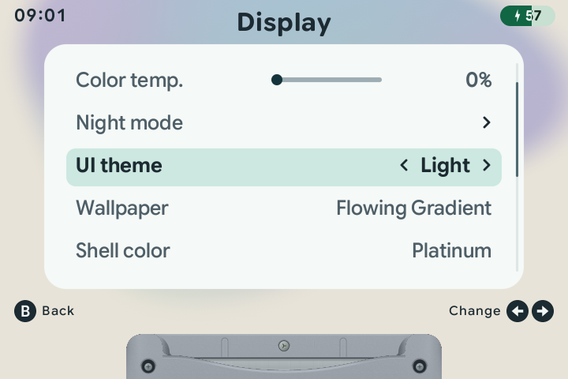
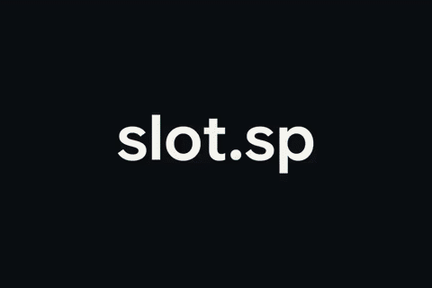

# 🎨 Appearance & screen

[← Overview](README.md) · [All guides](GUIDE.md)

[Colors](#colors) · [Backgrounds & animation](#backgrounds--animation) · [Screen effects & borders](#screen-effects--borders) · [Your own artwork](#your-own-backgrounds--borders)

## Text

Menus, game names and notices use Google Sans Flex. The selected setting has heavier text, and clock and percentage digits keep a fixed width as their values change. The About screen credits the typeface, artwork and symbols.

## Colors

Open **Menu → Display → Shell Color** to choose the SP artwork's color:

| Choice | Appearance |
| :--- | :--- |
| **Graphite** | Dark gray. |
| **Platinum** | Silver. |
| **Pearl Blue** | Blue. |
| **Pearl Pink** | Pink. |
| **Theme** | Graphite with the dark theme; Platinum with the light theme. |

The selected color also appears on the animated power switch and link screen. **Display → UI theme** chooses Dark or Light. Light uses a warm gray-beige background, white cards and dark green controls. Dark uses a dark background with teal controls. The clock, status icons and button hints change color to remain readable over custom wallpapers. During play, the game stays visible behind the settings card.

[Preview all four SP colors on the homepage](https://jakegraving.com/slot.sp/#intro-title).

## Backgrounds & animation

Open **Menu → Display**:

| Setting | What to choose |
| :--- | :--- |
| **Wallpaper** | Flowing Gradient, Static Gradient, None, Random, or one of your own images. |
| **Wallpaper Tint** | Darken a custom or random wallpaper in Dark mode, or lighten it in Light mode. |
| **Carousel motion** | Wheel places cartridges along a curved path; Classic keeps them in a horizontal line. Wheel is the default. |
| **Game Titles** | Choose Off, Clean names without tags, or the full Filename above the slot. |

**Power & lid → Boot Animation** shows or skips the startup animation. **Sound → Carousel sounds** controls the clicks between games. Clock format is in **General**.

**Flowing Gradient** animates the background; **Static Gradient** keeps it still. Both have separate Light and Dark colors. **None** uses a plain background. **Random** chooses one of your images from `Wallpapers/` at startup.

Custom and random wallpapers are lightened in Light mode. **Wallpaper Tint** adjusts how strongly they are lightened or darkened; it appears only for these wallpapers. Switching back to Dark restores their original colors.

## Screen effects & borders

Open **Menu → Display**, then choose **Game Boy Advance**, **Game Boy Color** or **Game Boy**. During a game, use **Menu → Settings → Screen** for the current system.

| Setting | What it changes |
| :--- | :--- |
| **Shader** | The screen effect: LCD3x, grid, dots or a simpler texture, depending on the system. |
| **Color Correction** | Adjust colors toward the original handheld's display. |
| **Palette** | Choose the colors for original Game Boy games. |
| **Bezel** | Choose the border around the game screen. |

Each system remembers its own settings. Game Boy palettes include **Auto**, grayscale, DMG Green, GB Pocket, GB Light, Game Boy Color presets and Super Game Boy palettes.

### Scaling

During a game, open **Menu → Settings → Screen**:

| Setting | What it does |
| :--- | :--- |
| **Scaling → Actual** | Keep the existing original-size presentation and borders. |
| **Scaling → Stretch** | Keep the existing stretched presentation. |
| **Scaling → Fit** | Enlarge the game as much as the panel allows while keeping its proportions. |
| **Scaling → Integer** | Use the largest whole-number pixel scale that fits, with centered black bars. |

Scaling is saved per game. On GB/GBC, **L1 / R1** cycle backward / forward through the four modes unless those buttons are mapped to game controls. GBA shoulder buttons keep their normal game functions. Fit and Integer hide the decorative border without changing its saved setting. On a panel smaller than the original game image, Integer falls back to fitting it without cropping.

### Frame blending

During a game, open **Menu → Settings → Screen → Frame Blending**. Choose **Mix** for games that use flickering transparency, such as F-Zero’s minimap.

Frame Blending is **Off** by default and is saved separately for GBA, GBC and GB. It uses the bundled emulator’s existing 50/50 mixing setting; emulator binaries are unchanged. Mixing can soften motion, so enable it for games that benefit. Live changes are unavailable during link play. The paused picture settles before it is shown, without advancing the saved game state.

### Display shortcuts

| Button | Action |
| :--- | :--- |
| <kbd>SELECT</kbd> + <kbd>A</kbd> / <kbd>B</kbd> | Next / previous shader. |
| <kbd>SELECT</kbd> + <kbd>Y</kbd> | Toggle color correction. |
| <kbd>SELECT</kbd> + <kbd>L2</kbd> / <kbd>R2</kbd> | Previous / next Game Boy palette. |
| <kbd>L1</kbd> / <kbd>R1</kbd>, in GB or GBC games | Previous / next scaling mode. |

The screen-size choice is remembered per game. Brightness and warmth have separate [day/night presets](NIGHT-DISPLAY.md).

### Automatic day and night

Set start times in **Display → Night mode** to change brightness and warmth automatically. This schedule is separate from the Light/Dark menu theme. See [Day & night](NIGHT-DISPLAY.md#switch-automatically) for setup and manual overrides.

## Your own backgrounds & borders

Place PNG backgrounds in `Wallpapers/`, then choose them in **Display → Wallpaper**.

You can also [copy wallpapers over Wi-Fi](SETTINGS.md#file-sharing). Open the handheld’s **SDCard** share, copy PNGs into **Wallpapers**, then eject the share and turn **Sharing** off on the handheld.

| Display | Background size |
| :--- | :--- |
| RG SP, RG34XX, RG34XXSP | 720 × 480 |
| RG35XXSP, RG35XX Plus, RG35XX-H, RG28XX | 640 × 480 |

Other sizes are scaled and cropped to fill the screen.

For a custom game border, put a PNG in `Bezels/GB/`, `Bezels/GBC/` or `Bezels/GBA/`, then choose it in that system's **Bezel** setting. Leave the game area transparent:

| Display size | GB/GBC picture area |
| :--- | :--- |
| 720 × 480 | 480 × 432, starting at x=120, y=24. |
| 640 × 480 | 427 × 384, starting at x=107, y=48. |

On a 640 × 480 display, the GBA picture is 640 × 427 at x=0, y=27. On a 720 × 480 display, GBA fills the screen. Borders are hidden in Stretch, Fit and Integer modes.

<strong>Use a custom startup image</strong>

Place a 24-bit BMP at `Config/bootlogo.bmp`, using the size of your device's startup image. This is the still image shown when the device powers on; **Boot Animation** controls the separate slot.sp animation.

Remove the custom BMP to return to the bundled startup image.

---

[Day & night](NIGHT-DISPLAY.md) · [Games & artwork](LIBRARY.md) · [Buttons & shortcuts](CONTROLS.md)
