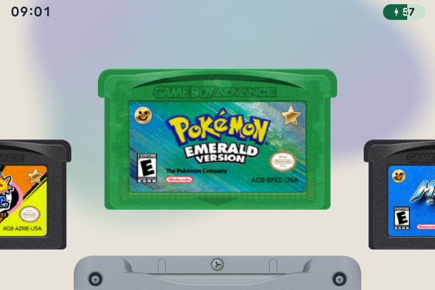

# 📖 User guide

[← slot.sp](README.md)

Browse your games as cartridges, press A to play, and use MENU for settings. This guide explains what each feature does and which buttons to use. For a new card, start with [installation](GETTING-STARTED.md).

## Find a feature

| Guide | What's inside |
| :--- | :--- |
| **[⬇ Installation & updates](GETTING-STARTED.md)** | Choose a download, prepare a card, add games and update an existing installation. |
| **[🕹️ Buttons & shortcuts](CONTROLS.md)** | Default controls for the carousel, games and menus; remapping your buttons. |
| **[⭐ Games & artwork](LIBRARY.md)** | Browse systems, sort Favorites by name or play history, and add labels and cartridge colors. |
| **[🎨 Cart Studio](CART-STUDIO.md)** | Find labels and logos, change colors and finishes, edit several cartridges together, and save to a card or ZIP. |
| **[💾 Playing & saving](PLAYING.md)** | Resume a game, save a snapshot, undo a save or load, choose an emulator, and use fast-forward, rewind or turbo. |
| **[📸 Screenshots](SCREENSHOTS.md)** | Capture, browse, zoom and manage pictures. |
| **[🎨 Appearance & screen](DISPLAY.md)** | Light and Dark themes, SP colors, wallpapers, startup animation, screen effects, palettes and picture size. |
| **[🌗 Day & night](NIGHT-DISPLAY.md)** | Save brightness and screen warmth for day and night. Switch manually or set a schedule. |
| **[🎧 Audio & headphones](BLUETOOTH.md)** | Use Bluetooth, USB or wired audio; remember each volume and choose what happens on a disconnect. |
| **[🙂 Kid mode](KID-MODE.md)** | Approve games, set daily, session or bedtime limits, cap volume, and protect settings with a parent code. |
| **[⏻ Sleep & power](POWER-OPTIONS.md)** | Choose lid and sleep behavior, set a shutdown timer, understand charging notices and set the clock. |
| **[🔗 Link play](LINK-PLAY.md)** | Connect two nearby handhelds for supported multiplayer games and trading. |
| **[⚙ Settings](SETTINGS.md)** | Find each settings tile, change options during play, and understand status icons and notices. |

## Your first few minutes

1. Use <kbd>Left</kbd> and <kbd>Right</kbd> to choose a game, then tap <kbd>A</kbd> to play.
2. Tap <kbd>MENU</kbd> during play to open the game menu.
3. Back on the carousel, press <kbd>Y</kbd> to add a game to Favorites.
4. Open **Menu → General** to choose the **UI theme**, **Shell Color** and **Wallpaper**.
5. Try <kbd>SELECT</kbd> + <kbd>X</kbd> to switch to the night display preset.

## Reading the controls

A **tap** means press and release. A **hold** means keep the button pressed. For a combination such as <kbd>SELECT</kbd> + <kbd>X</kbd>, press the buttons together, then release. Hold only where the instructions say to.

The guides show the default controls. If you remap them, the on-screen button hints follow your choices. Kid mode has its own [short menu](KID-MODE.md#the-kid-menu).

## Reference

[Settings](SETTINGS.md) · [Card folders](https://jakegraving.com/slot.sp/guide/storage/) · [Custom artwork & BIOS](https://jakegraving.com/slot.sp/guide/customizing/) · [Troubleshooting](https://jakegraving.com/slot.sp/guide/troubleshooting/)

## About the examples

Images and clips are made with the current interface and sample cartridges. Example gameplay and gallery pictures use test patterns. slot.sp does not include games. Gallery examples use Light mode. Save-state and link examples use Dark mode.
