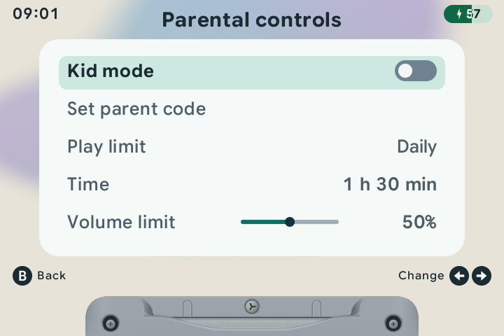
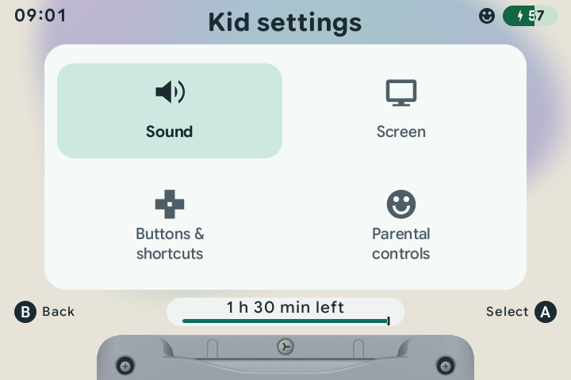
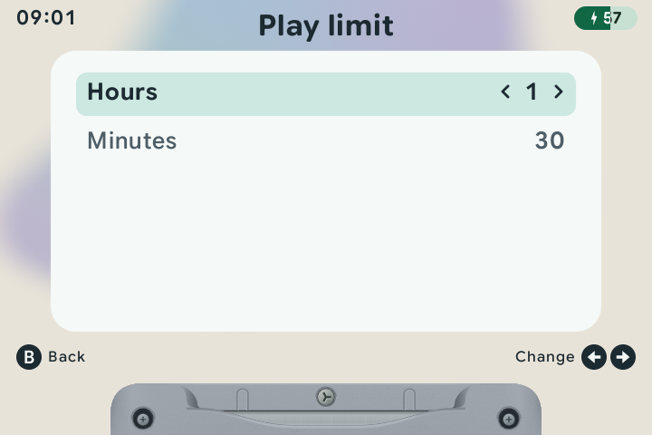
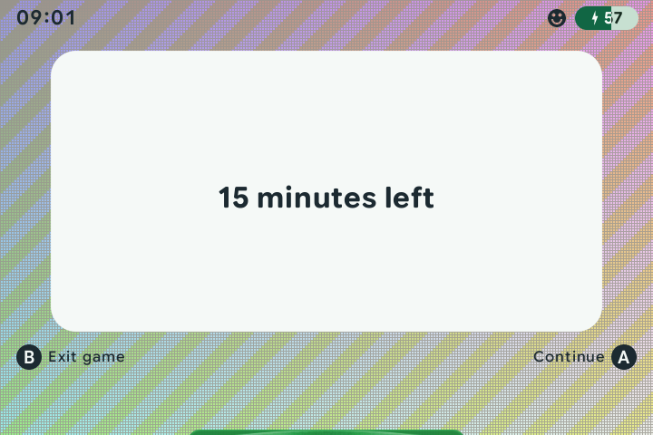
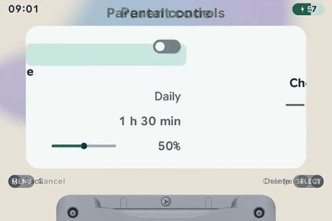

# 🙂 Kid mode

[← Overview](README.md) · [All guides](GUIDE.md)

[Set up](#set-it-up) · [Kid menu](#the-kid-menu) · [Limits](#time--volume-limits) · [Time reminders](#time-reminders) · [Approvals](#approve--remove-games) · [Parent code](#the-parent-code)

Choose which games children can play, set a time allowance and cap the volume. Children keep the regular system, Favorites and Recents carousels, filtered to the games you approve.

## Set it up

1. Set the handheld's clock in **Menu → General → Date & Time**.
2. With kid mode off, browse the carousel and press <kbd>X</kbd> on each game you want to allow. A gold smiley marks approved games.
3. Open **Menu → Parental controls**.
4. Choose a **Play limit**, set the **Time**, and adjust the **Volume limit**.
5. Turn on the **Kid mode** switch at the top. Green means on; gray means off.
6. If you have not set a parent code, enter four buttons, then enter the same four buttons again to confirm. Each screen advances automatically.



You can also set the code separately through **Set parent code**. Kid mode starts off on a new installation.

## The kid menu

During a game, tap <kbd>MENU</kbd> for **Resume**, **Settings** and **Exit game**. Settings opens a simple four-tile menu. On the carousel, <kbd>MENU</kbd> opens this same grid:

| Tile | What children can do |
| :--- | :--- |
| **Sound** | Adjust volume within the parent's cap. |
| **Screen** | Adjust screen brightness. |
| **Buttons & shortcuts** | Read the kid-friendly control guide. Left / Right change pages and B returns. |
| **Parental controls** | Enter the parent code to change limits or turn kid mode off. |



Use the D-pad to select a tile, <kbd>A</kbd> to open it and <kbd>B</kbd> to return. In Sound and Screen, use <kbd>Left</kbd> / <kbd>Right</kbd> to adjust the value. <kbd>MENU</kbd> closes the menu. Children can browse, play and leave games without entering a code. Parent dialogs pause and mute the game.

## Time & volume limits

| Parent setting | How it works |
| :--- | :--- |
| **Play limit → Daily** | Counts active gameplay against an allowance for the day. Pauses and sleep do not use that allowance. Usage is kept across restarts and renews on the next calendar day. |
| **Play limit → Duration** | Starts a timed session when enabled or when its time settings change. Sleep and reboot do not extend the deadline. |
| **Play limit → Bedtime** | Allows play until the chosen time today. |
| **Time** | Daily/Duration: 5 minutes to 4 hours, shown as hours and minutes. Tap left/right to change one minute, or hold to keep adjusting. Press A to adjust Hours and Minutes separately. Bedtime follows **General → Clock format**, with 12-hour or 24-hour display. |
| **Volume limit** | 0–100%, in ten-point steps. Starts at 50% and applies across audio outputs while kid mode is on. |



Settings save as you change them. Changing the volume cap does not restart the session timer. Normal parent adjustments keep an approved game paused in place, ready to resume.

When time is up, play stops and the carousel asks for a parent. Choose **Parents**, enter your code and adjust the time settings to allow more play.

## Time reminders

During play, the game pauses to show how much time is left at **1 hour, 30 minutes, 15 minutes, 5 minutes and 1 minute**. Short sessions skip reminders at or above their starting length. Press <kbd>A</kbd> to continue or <kbd>B</kbd> to exit the game. No parent code is needed for these choices.



Each reminder appears once for the current allowance or session, including across restarts. After waking, one reminder shows the current time left if several reminders were passed while asleep.

While kid mode is on, the kid menu and parent settings show a **remaining-time bar**. Daily allowance pauses while a menu or reminder is open, or while the handheld sleeps. Duration and Bedtime keep their fixed deadlines. If a deadline arrives while a reminder is open, the screen changes to the end-of-time notice.

## Approve & remove games

With kid mode off, browse the carousel and press <kbd>X</kbd> on a cartridge to approve it. A **gold smiley at the top left** marks approved games.

To remove approval, press <kbd>X</kbd>, release it and press it again within three seconds. Moving away or waiting cancels the confirmation.


Your full Favorites and Recents lists are kept. Turning kid mode off shows them again.

## The parent code

Use four presses from <kbd>A</kbd>, <kbd>B</kbd>, <kbd>X</kbd>, <kbd>Y</kbd>, the D-pad, or <kbd>L1</kbd>, <kbd>R1</kbd>, <kbd>L2</kbd> and <kbd>R2</kbd>. Each press shows its button picture on screen. The fourth button checks the code automatically. A correct code opens parent settings. An incorrect code shakes the icons, then clears them for another try.



| Button | Action |
| :--- | :--- |
| <kbd>A</kbd> / <kbd>B</kbd> / <kbd>X</kbd> / <kbd>Y</kbd> / D-pad / <kbd>L1</kbd> / <kbd>R1</kbd> / <kbd>L2</kbd> / <kbd>R2</kbd> | Enter a button in the code. |
| <kbd>SELECT</kbd> | Delete the last entry. |
| <kbd>MENU</kbd> | Cancel code entry. |

To change the code, open **Parental controls**, unlock it and choose **Set parent code**. Enter and confirm the new code. A mismatched confirmation shakes and clears; re-enter the confirmation to try again.

### Turn kid mode off

Open **Menu → Parental controls**, enter the code and change **Kid mode → Off**. Press <kbd>B</kbd> to return. There is no separate Apply step.

### Recover a forgotten code

Shut down and open the content card on a computer. Read:

```text
Config/kids/parent-code.txt
```

The recovery file contains the four buttons in plain text. Keep access to the card with the parent who manages the code.

---

[Buttons & shortcuts](CONTROLS.md) · [Games & artwork](LIBRARY.md) · [Audio & headphones](BLUETOOTH.md)
