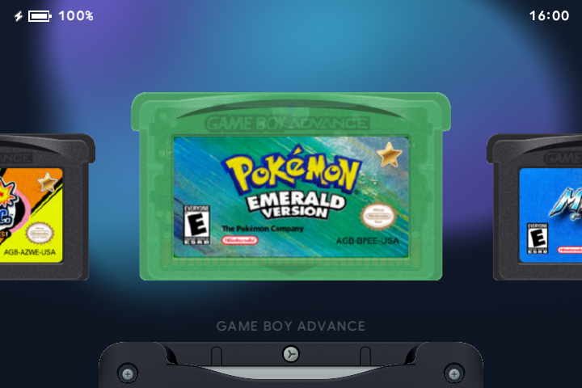
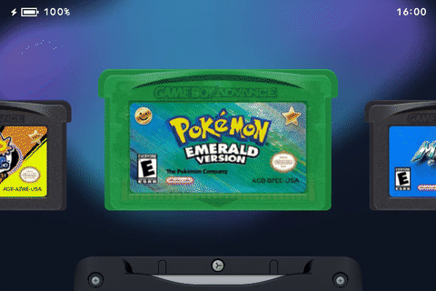

# ⭐ Games & artwork

[← Overview](README.md) · [All guides](GUIDE.md)

[Browsing](#browse-your-games) · [Favorites & Recents](#favorites--recents) · [Labels](#game-artwork) · [Cartridge colors](#cartridge-colors)

## Browse your games

Use <kbd>Left</kbd> and <kbd>Right</kbd> to move through cartridges. Tap <kbd>A</kbd> to launch one. Hold <kbd>A</kbd> to start from the title screen instead of a resume state.

<kbd>L1</kbd> and <kbd>R1</kbd> switch between Recents, Favorites and the system carousels: Game Boy Advance, Game Boy Color and Game Boy. Empty carousels are hidden.

Games are sorted by name. <kbd>Up</kbd> and <kbd>Down</kbd> jump between starting letters. To display game names above the slot, turn on **Menu → General → Game Titles**.



## Favorites & Recents

| Collection | How to use it |
| :--- | :--- |
| **Favorites** | Press <kbd>Y</kbd> on a game to add its star. Favorites from all three systems appear together. |
| **Recents** | Enable **Menu → General → Recents** to see your last ten games. |

### Remove a favorite

Press <kbd>Y</kbd> on a starred game. A prompt appears above it. Release <kbd>Y</kbd> and press it again within three seconds to remove the star. Moving to another game, leaving the carousel or waiting cancels the prompt.



### Mark games for children

With kid mode off, press <kbd>X</kbd> on a cartridge to approve it. A gold smiley appears at the top left. Removing approval uses the same release-and-press-again confirmation.

Manage approvals directly on the carousel with kid mode off. See the [kid-mode guide](KID-MODE.md) for the parent code and limits.

## Game artwork

Match a label PNG to the game's filename and system:

```text
Games/GBA/Metroid Fusion.gba
Labels/GBA/Metroid Fusion.png
```

| Game type | Label folder | Suggested artwork size |
| :--- | :--- | :--- |
| Game Boy Advance | `Labels/GBA/` | 1280 × 661 |
| Game Boy Color | `Labels/GBC/` | 1024 × 914 |
| Game Boy | `Labels/GB/` | 1024 × 914 |

slot.sp detects rounded label scans with black corners and cleans the background around them automatically. Transparent corners show the cartridge color underneath. Your original PNGs stay unchanged.

Restart after adding artwork. **Menu → About**, then <kbd>X</kbd>, restarts the launcher.

**[Open Cart Studio](https://jakegraving.com/slot.sp/studio/)** to find artwork, design labels and choose cartridge colors. Save to the card or download a ZIP. See the [Cart Studio guide](CART-STUDIO.md) for the steps.

## Cartridge colors

You can change the color and finish of individual cartridges. Add an entry to `Labels/cart_shell.txt` using the game's filename without its extension:

```text
Metroid Fusion = auto 6a3fa0 solid
```

| Part | Choices | Example |
| :--- | :--- | :--- |
| Shape | `auto`, `notched`, `rounded` | `auto` chooses the usual shape for the game. |
| Color | Six hexadecimal digits, without `#` | `6a3fa0` |
| Finish | `solid`, `clear`, `glitter` | `solid` |

Use lowercase for these values. Shape choices apply to Game Boy cartridges. Restart to load changes.

---

[Add games](GETTING-STARTED.md#add-games) · [Appearance & screen](DISPLAY.md) · [Kid mode](KID-MODE.md)
