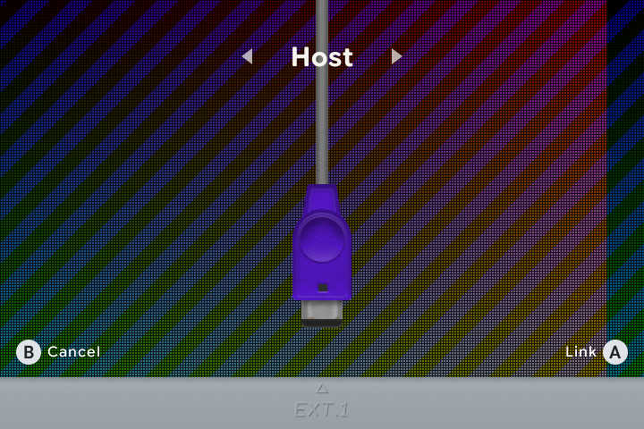

# 🔗 Local link play

[← Overview](README.md) · [All guides](GUIDE.md)

[Connect](#host--join) · [Emulator choice](#choose-the-link-mode) · [Disconnect](#finish-a-session)

Connect two nearby handhelds running slot.sp for supported multiplayer games or trading. One device hosts a local Wi-Fi network and the other joins it. A separate Wi-Fi router is not needed.

## Host & join

1. Open the game on both devices.
2. On each device, hold <kbd>SELECT</kbd> and tap <kbd>MENU</kbd>.
3. Choose **Host** on one device and **Join** on the other. Use <kbd>Left</kbd> / <kbd>Right</kbd> to choose, then <kbd>A</kbd> to connect.
4. Wait for **Linked**, then use the game's own multiplayer or trading menu.

Keep the devices close together. Starting Host before Join gives the second player a network to connect to.

| Link screen button | Action |
| :--- | :--- |
| <kbd>Left</kbd> / <kbd>Right</kbd> | Choose Host or Join. |
| <kbd>A</kbd> | Start the selected connection. |
| <kbd>B</kbd> | Go back. |
| <kbd>SELECT</kbd>, when offered | Switch cable / wireless-adapter mode. |

## Choose the link mode

For GBA games, press <kbd>START</kbd> on the carousel to choose the emulator for each game before linking.

| Emulator | Link options |
| :--- | :--- |
| **mGBA** | Game Boy, Game Boy Color and GBA cable-style play. The joining device runs the host's game for the session. |
| **gpSP** | Cable support for Pokémon and the two Advance Wars games; wireless-adapter support for Pokémon FireRed, LeafGreen and Emerald. |

For FireRed, LeafGreen and Emerald on gpSP, <kbd>SELECT</kbd> on the link screen switches between cable and wireless-adapter modes when offered.

Use matching BIOS setups on both devices. If you use a custom BIOS file, copy the same file to each device's `BIOS/` folder.

## During a session

The host/join badge shows your role. Menus leave the linked game running so both devices stay together. Fast-forward, rewind and state loading are paused for the link session.

With mGBA, the joining player's own game save and resume state stay in place while playing the host's game.

## Finish a session

Open the link screen again with <kbd>SELECT</kbd> + <kbd>MENU</kbd> and choose **End Link**. Exiting the game, closing the lid or powering off also ends the connection.

---

[Choose an emulator](PLAYING.md#choose-an-emulator) · [Buttons & shortcuts](CONTROLS.md)
