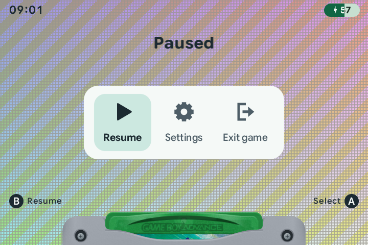
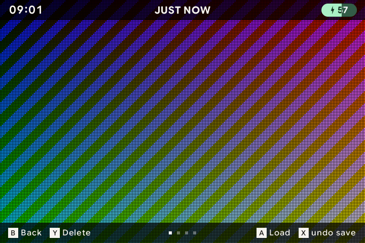
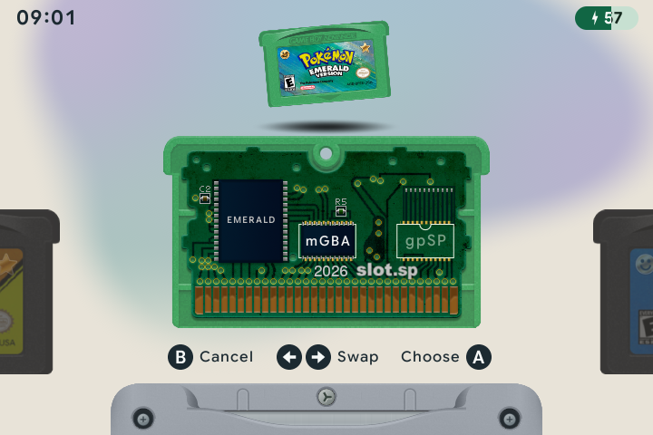

# 💾 Playing & saving

[← Overview](README.md) · [All guides](GUIDE.md)

[Launch & exit](#launch--exit) · [Saving](#save--resume) · [Save states](#save-states--undo) · [Emulators](#choose-an-emulator) · [Speed controls](#fast-forward-rewind--turbo)

## Launch & exit

On the carousel, tap <kbd>A</kbd> to launch a game. When **Load State on Insert** is on, it picks up from its resume state. Hold <kbd>A</kbd> to start from the title screen instead; the game's own save remains available.

During play, tap <kbd>MENU</kbd> for **Resume**, **Settings** and **Exit game**. **Save states**, **Screenshots** and temporary undo choices appear when available. Settings opens the same complete settings home as the carousel, floating over the game picture. Hold <kbd>MENU</kbd> to save on exit when enabled and return to the carousel.

Kid mode uses a [shorter menu](KID-MODE.md#the-kid-menu) with Resume, Settings and Exit game. Its settings are a four-tile grid.

## Save & resume

There are three ways to keep your place:

| Save type | What it keeps | How to use it |
| :--- | :--- | :--- |
| **Game save** | Progress saved through the game's own menu. | Save as you would on the original Game Boy. Files are kept in `Saves/`. |
| **Resume state** | A snapshot used when you next launch or resume the game. | Written periodically, before sleep and shutdown, and on exit when enabled. |
| **Manual save state** | A moment you choose to keep. | Save with <kbd>SELECT</kbd> + <kbd>R1</kbd>, then return through the state browser. |

Open **Menu → Gameplay** from the carousel, or **Menu → Settings → Gameplay** during play:

| Setting | Effect |
| :--- | :--- |
| **Load State on Insert** | Launch games from their resume state. Turn it off to start at the title screen by default. |
| **Save State on Eject** | Write a resume state when you exit a game. |

The resume snapshot is also refreshed every five minutes of play. Closing the lid or sleeping saves your place before pausing.

## Save states & undo

| Button | Action |
| :--- | :--- |
| <kbd>SELECT</kbd> + <kbd>R1</kbd> | Save a state. |
| <kbd>SELECT</kbd> + <kbd>L1</kbd> | Load the newest state. |
| Double-tap <kbd>MENU</kbd> | Browse states. You can also choose **Save states** from the game menu. |

The browser shows snapshots of your saves. Each game keeps ten manual states, with the oldest replaced when you save another.

| In the browser | Action |
| :--- | :--- |
| <kbd>Left</kbd> / <kbd>Right</kbd> | Browse snapshots. |
| <kbd>A</kbd> | Load the selected state. |
| <kbd>X</kbd> | Undo the last save or load, while undo is available. |
| <kbd>Y</kbd> | Request deletion of the selected state. <kbd>X</kbd> confirms; <kbd>B</kbd> cancels. |
| <kbd>B</kbd> | Return to the pause menu if opened there, or to the game if opened by shortcut. |

**Undo Save** and **Undo Load** also appear in the game menu when available. You have 30 seconds to undo the last operation. Undoing a save restores the previous state list; undoing a load restores the game as it was before that load.

## Choose an emulator

Press <kbd>START</kbd> on a GBA cartridge to open its circuit-board view. Use <kbd>Left</kbd> or <kbd>Right</kbd> to choose **mGBA** or **gpSP**, then <kbd>A</kbd> to save. <kbd>B</kbd> or <kbd>START</kbd> closes the picker. The choice is remembered for that game.

| Emulator | Use |
| :--- | :--- |
| **mGBA** | The default for GBA; also runs all Game Boy and Game Boy Color games. |
| **gpSP** | An alternative for GBA, including its supported cable and wireless-adapter link modes. |

> [!NOTE]
> Game saves are shared between the two GBA emulators. Save states belong to the emulator that created them. Save inside the game before switching emulators; your existing states are still there when you switch back.

## Fast-forward, rewind & turbo

| Control | Action |
| :--- | :--- |
| Hold <kbd>R2</kbd> | Fast-forward while held. |
| Double-tap <kbd>R2</kbd> | Keep fast-forward on. Press it again to stop. |
| Hold <kbd>L2</kbd> | Rewind through recent play. |
| Hold <kbd>X</kbd> | Turbo A. |
| Hold <kbd>Y</kbd> | Turbo B. |

In **Gameplay**, choose a fast-forward cap of **1.5×, 2×, 3×, 4× or 6×**, or turn it off. **Fast Forward Sound** controls audio during fast-forward. **Rewind** and **Turbo Buttons** can each be turned on or off.

Use **Device controls → In-Game** to move the turbo buttons, and **Device controls → Shortcuts** to change fast-forward or rewind bindings. Assign **Fast Forward Toggle** to start fast-forward with one press and stop it with the next. It is unassigned by default. Assigning it to the same button as **Fast Forward** replaces that hold binding.

---

[Screenshots](SCREENSHOTS.md) · [Buttons & shortcuts](CONTROLS.md) · [Link play](LINK-PLAY.md)
