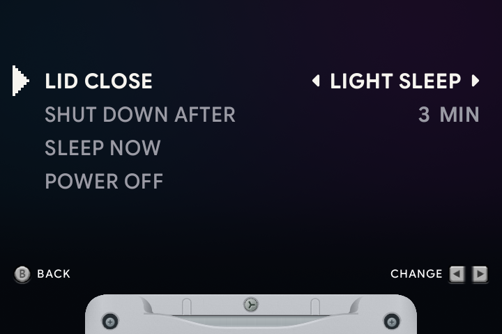

# ⏻ Sleep & power

[← Overview](README.md) · [All guides](GUIDE.md)

[Lid behavior](#choose-what-the-lid-does) · [Shutdown timer](#set-a-shutdown-timer) · [Buttons](#power-buttons) · [Clock](#set-the-clock)

Open **Menu → Power** from the carousel. Choose how the handheld sleeps, how long it waits before shutting down and when to power off.

## Choose what the lid does

Change **Lid Close**:

| Choice | When you close the lid | How to return |
| :--- | :--- | :--- |
| **Light Sleep** | Saves and pauses the game, then turns off the screen. This is the default. | Open the lid, or tap Power. |
| **Deep Sleep** | Saves and pauses, then suspends the device. | Press Power to wake on RG SP. |
| **Power Off** | Saves and shuts down. | Power on again. |

**Sleep Now** uses deep sleep when Lid Close is set to Deep Sleep. With the other choices, it uses light sleep.

## Set a shutdown timer

**Shut Down After** offers **1, 3, 5, 10, 15 or 30 minutes**, or **Never**. The default is three minutes.

The timer runs while the handheld is sleeping. It does not limit a game while you are playing. Waking before the timer expires returns you to the game; reaching the limit shuts the handheld down.

For limits on active play, use [kid mode](KID-MODE.md#time--volume-limits).

## Power buttons

| Control | Action |
| :--- | :--- |
| Tap <kbd>POWER</kbd> | Sleep; tap again to wake from light sleep. |
| Hold <kbd>POWER</kbd> | Save and power off. |
| **Power → Sleep Now** | Sleep using the behavior described above. |
| **Power → Power Off** | Save and shut down with the animated switch. |
| **About →** <kbd>X</kbd> | Restart the launcher, useful after adding games or labels. |

The animated power switch follows your selected SP color. Power settings are remembered across restarts.

## Set the clock

Open **Menu → General → Date & Time**.

| Button | Action |
| :--- | :--- |
| <kbd>Left</kbd> / <kbd>Right</kbd> | Choose a field. |
| <kbd>Up</kbd> / <kbd>Down</kbd> | Change its value. |
| <kbd>A</kbd> | Set the clock. |
| <kbd>B</kbd> | Return to settings. |

The clock uses 24-hour time. The last field is your time zone's offset from UTC. This time is also used by games with clocks and by kid-mode limits.

<strong>Where power preferences are saved</strong>

Lid behavior and the shutdown timer are saved in `Config/power.txt`. Change them through the Power menu.

---

[Day & night](NIGHT-DISPLAY.md) · [Playing & saving](PLAYING.md) · [Kid mode](KID-MODE.md)
