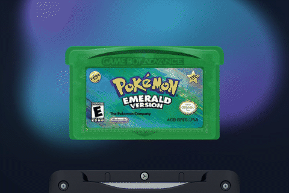
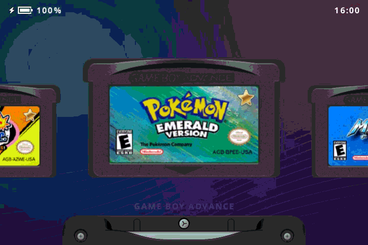
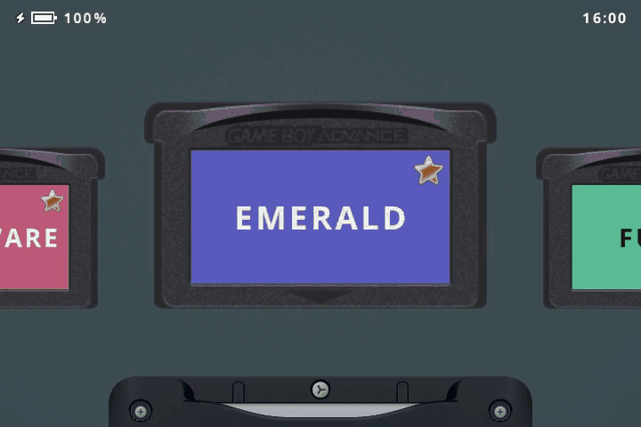
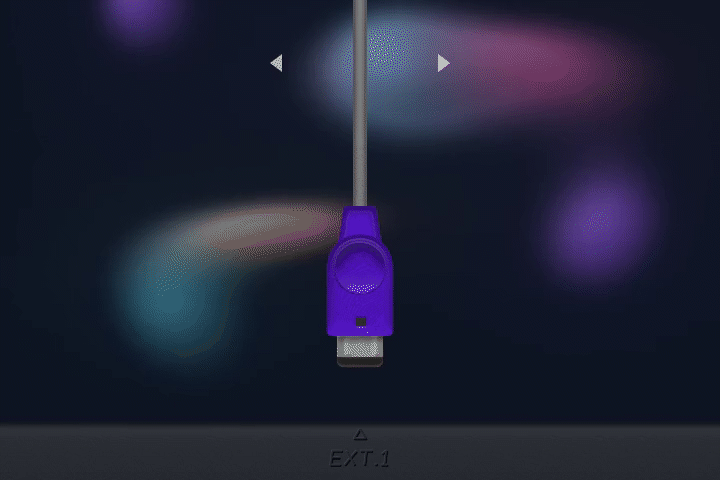
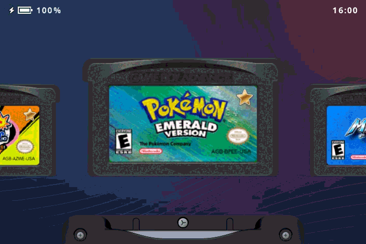

<picture>
  <source media="(prefers-reduced-motion: reduce)" srcset="previews/hero-static.svg">
  
</picture>

**Game Boy games. SP style.**

Game Boy · Game Boy Color · Game Boy Advance

**[⬇ Download update](https://github.com/jgraving/slot.sp/releases/latest/download/slot.sp-System.zip)** · **[Website](https://jgraving.github.io/slot.sp/)** · **[Get started](GETTING-STARTED.md)** · **[User guide](GUIDE.md)**

**slot.sp** is a game launcher for Anbernic handhelds, with graphics based on the Game Boy Advance SP. Browse your games as cartridges and press **A** to play.

## Features

| | What you get |
| :--- | :--- |
| 🔤 **[Google Sans Flex](DISPLAY.md#type)** | Bolder selections, steady numbers and readable small text. |
| 🎨 **[Four SP colors](DISPLAY.md#colors)** | Graphite, Platinum, Pearl Blue and Pearl Pink, with matching power-switch and link-screen artwork. |
| 🖼️ **[Larger game artwork](LIBRARY.md#game-artwork)** | Bigger cartridges and labels, with automatic cleanup around rounded label corners. |
| ⭐ **[Favorites & Recents](LIBRARY.md#favorites--recents)** | Keep favorite games together and return to the ones you played last. |
| 🌊 **[Animation & backgrounds](DISPLAY.md#backgrounds--animation)** | Flowing gradients, an optional glass logo animation and soft carousel clicks. |
| 🌗 **[Day & night presets](NIGHT-DISPLAY.md)** | Switch between your saved brightness and warmth settings with one shortcut. |
| 🎧 **[Audio choices](BLUETOOTH.md)** | Speaker, wired headphones, Bluetooth and USB audio. Separate volumes, saved Bluetooth pairings and automatic reconnect. |
| 🙂 **[Kid mode](KID-MODE.md)** | Approved games, playtime warnings and limits, a volume cap, and a simple menu for kids to resume, adjust volume or brightness, and exit a game. |
| 💾 **[Save & resume](PLAYING.md#save--resume)** | Resume when you launch, periodic saves, a save-state browser and undo for the last save or load. |
| 📸 **[Screenshots](SCREENSHOTS.md)** | Capture a moment, browse thumbnails, zoom in and select several pictures at once. |
| ⏩ **[Fast-forward, rewind & turbo](PLAYING.md#fast-forward-rewind--turbo)** | Speed through familiar sections, go back a few seconds or repeat a button while you hold it. |
| ⚙️ **[Emulator choice](PLAYING.md#choose-an-emulator)** | Choose mGBA or gpSP for each GBA game from its animated circuit-board view. |
| 🕹️ **[Your controls](CONTROLS.md#change-a-button)** | Remap game buttons, carousel controls and shortcuts. |
| 🔗 **[Local link play](LINK-PLAY.md)** | Host or join a nearby device for multiplayer games and trading. |
| ⏻ **[Sleep & power](POWER-OPTIONS.md)** | Choose light or deep sleep, set a shutdown timer and watch the power switch slide off. |

## In motion

## Download

| Already using slot? | Setting up a new card? |
| :--- | :--- |
| **[System update ZIP](https://github.com/jgraving/slot.sp/releases/latest/download/slot.sp-System.zip)** | **[Full SD2 ZIP](https://github.com/jgraving/slot.sp/releases/latest/download/slot.sp-SD2.zip)** |
| Replace the `System` folder on your content card. Your games, saves and settings stay in place. | Get the game folders and starting settings, then follow the [installation guide](GETTING-STARTED.md#first-installation). |

[All releases](https://github.com/jgraving/slot.sp/releases/latest) · [Installation & updates](GETTING-STARTED.md) · [Buttons & shortcuts](CONTROLS.md) · [All feature guides](GUIDE.md)

## Credits

**slot.sp by Jake Graving**, based on [slot by Brandon T. Kowalski](https://github.com/BrandonKowalski/slot). Original artwork by [MarkusMaribu](https://github.com/MarkusMaribu). Emulation by [mGBA](https://mgba.io) and [gpSP](https://github.com/libretro/gpsp). BaseOS by [Prashant Vaibhav](https://github.com/pvaibhav/slot).

[GPL-3.0-or-later](LICENSE) · [Full credits](site/docs/credits.md) · [Development disclosure](site/docs/ai.md)
