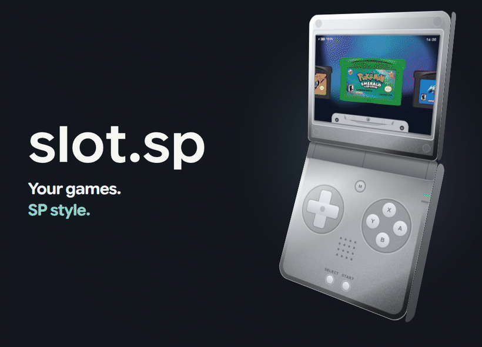

<picture>
  <source media="(prefers-reduced-motion: reduce)" srcset="previews/readme-model/hero.png">
  
</picture>

**[Website & guide](https://jakegraving.com/slot.sp/)** · **[New installation](https://jakegraving.com/slot.sp/installing/)** · **[Update](https://jakegraving.com/slot.sp/updating/)** · **[Cart Studio](https://jakegraving.com/slot.sp/studio/)**

**slot.sp** is a game launcher for Anbernic handhelds, inspired by the SP. Browse your games as cartridges, press **A** and play.

🎨 Four SP colors · 🙂 Kid mode with time limits · 🎧 Bluetooth & USB audio · 🌗 Light & dark themes · Scheduled day/night presets · 💾 Save & resume · ⭐ Favorites sorting & Recents · 🕹️ Remappable buttons

**[Explore the features and controls →](https://jakegraving.com/slot.sp/features/guide/)**

## Credits

By **Jake Graving**, based on [slot by Brandon T. Kowalski](https://github.com/BrandonKowalski/slot), with original artwork by [MarkusMaribu](https://github.com/MarkusMaribu).

[GPL-3.0-or-later](LICENSE) · [Full credits](https://jakegraving.com/slot.sp/credits/) · [Development disclosure](https://jakegraving.com/slot.sp/ai/)
