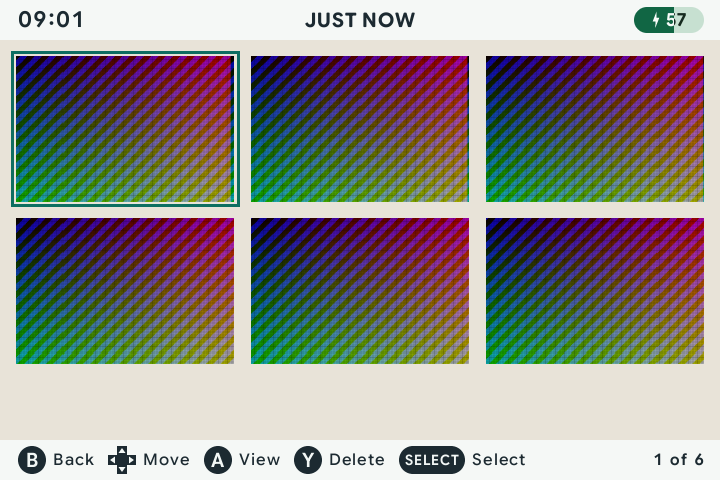
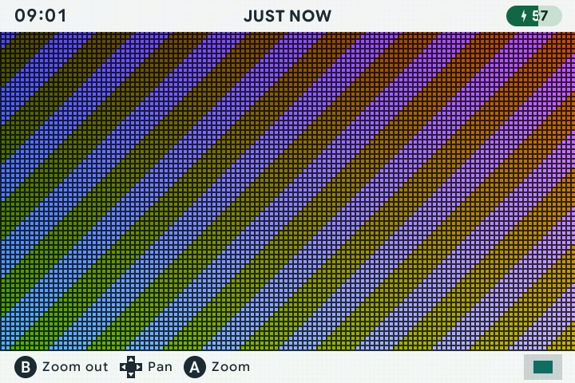
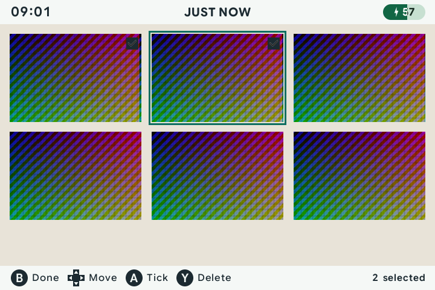

# 📸 Screenshots

[← Overview](README.md) · [All guides](GUIDE.md)

[Capture](#take-a-screenshot) · [Browse & zoom](#browse--zoom) · [Select & delete](#select--delete) · [Files](#find-your-pictures)

Save pictures of a game, view them on the handheld, or copy the PNG files to your computer. The gallery supports zooming and deleting several pictures together.

## Take a screenshot

During a game, press <kbd>MENU</kbd> + <kbd>X</kbd> together, then release both buttons. Avoid holding <kbd>MENU</kbd> on its own: that exits the game.

To change this combination, open **Menu → Device controls → Shortcuts → Screenshot** from the carousel and record a new binding.

## Browse & zoom

Open the game's menu with <kbd>MENU</kbd>, then choose **Screenshots**. The Screenshots choice appears once a picture exists. Pictures appear as thumbnails, newest first. The footer shows the buttons for the current view, using the same button icons as settings. The gallery follows your Light or Dark theme.



| View | Button | Action |
| :--- | :--- | :--- |
| Thumbnails | D-pad | Move between pictures. |
| Thumbnails | <kbd>A</kbd> | Open a picture. |
| Open picture | <kbd>Left</kbd> / <kbd>Right</kbd> | Previous / next picture. |
| Open picture | <kbd>A</kbd> | Zoom in, up to 4×. |
| Zoomed picture | D-pad | Pan around the picture. |
| Zoomed picture | <kbd>B</kbd> | Zoom out. |
| Open picture | <kbd>B</kbd> | Return to thumbnails. |
| Thumbnails | <kbd>B</kbd> | Return to the pause menu, with Screenshots selected. |



## Select & delete

### Delete one picture

1. Highlight a thumbnail or open the picture.
2. Press <kbd>Y</kbd>.
3. Press <kbd>X</kbd> to confirm deletion, or <kbd>B</kbd> to cancel.

### Delete several pictures

1. In the thumbnail view, press <kbd>SELECT</kbd> for multi-select.
2. Move with the D-pad and press <kbd>A</kbd> to tick or untick pictures.
3. Press <kbd>Y</kbd> to request deletion of the selected pictures.
4. Press <kbd>X</kbd> to confirm, or <kbd>B</kbd> to cancel.

Press <kbd>B</kbd> or <kbd>SELECT</kbd> in multi-select to return to normal browsing.



## Find your pictures

Pictures are PNG files on your content card:

```text
Screenshots/<system>/<game>/<timestamp>.png
```

For example, screenshots from a GBA game named `Metroid Fusion.gba` go into `Screenshots/GBA/Metroid Fusion/`. Copy the PNGs to your computer to share them.

---

[Playing & saving](PLAYING.md) · [Buttons & shortcuts](CONTROLS.md)
