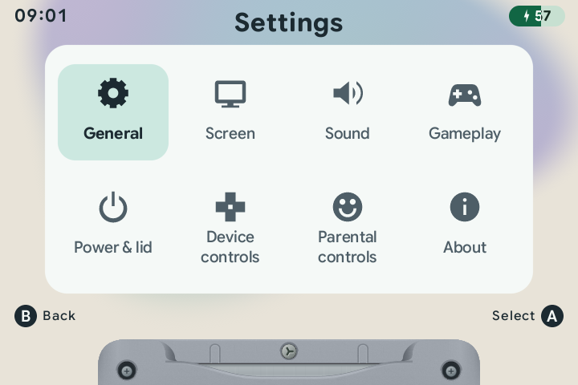
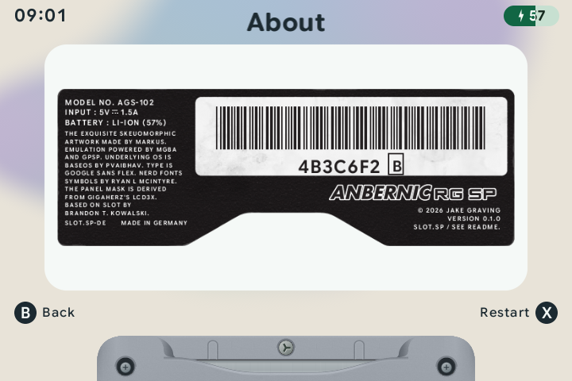

# Settings reference

Tap <kbd>MENU</kbd> on the carousel to open the settings grid. During a game, tap <kbd>MENU</kbd> and choose **Settings** to open the same settings grid. Changes save as you make them.

Use the D-pad to select a tile, <kbd>A</kbd> to open its card and <kbd>B</kbd> to return. Inside a card, Up/Down chooses a row; Left/Right changes its value. Follow the on-screen hints for editors and confirmations.

| Tile | Use it for | Instructions |
| :--- | :--- | :--- |
| **General** | Light or Dark menus, SP color, wallpaper, Favorites order, carousel motion, Recents, game names, startup animation, carousel sounds, clock format and date/time. | [Appearance & screen](DISPLAY.md) |
| **Screen** | Brightness, screen warmth and day/night schedules, plus screen effects, palettes and borders for each system. | [Screen](DISPLAY.md#the-game-picture) · [Day & night](NIGHT-DISPLAY.md) |
| **Sound** | Choose an audio output, pair headphones, set volume after a disconnect and optionally pause when audio disconnects. | [Audio & headphones](BLUETOOTH.md) |
| **Gameplay** | Automatic resume and saving on exit, fast-forward speed and sound, rewind, turbo and rumble where supported. | [Playing & saving](PLAYING.md) |
| **Power & lid** | Lid behavior, sleep and shutdown timer. | [Sleep & power](POWER-OPTIONS.md) |
| **Device controls** | Game buttons, carousel buttons, shortcuts and the on-device reference. | [Buttons & shortcuts](CONTROLS.md) |
| **Parental controls** | Approved games, daily allowance, session timer or bedtime, maximum volume and the four-button parent code. | [Kid mode](KID-MODE.md) |
| **About** | Version and credits. Press <kbd>X</kbd> to restart the launcher. | [Credits](https://jakegraving.com/slot.sp/credits/) |

## During a game

Settings float over the game picture. Screen opens picture controls for the current system; open **Screen → Night mode** from the carousel to edit the automatic schedule. Tap <kbd>MENU</kbd> for **Resume**, **Settings** and **Exit game**. **Save states**, **Screenshots** and undo choices appear when available.

In kid mode, **Settings** opens four tiles: Sound, Screen, Buttons & shortcuts and Parental controls. See the [kid menu](KID-MODE.md#the-kid-menu).

## Light, dark, day and night

**General → UI theme** changes the interface palette. **Screen → Night mode** changes saved brightness and warmth settings, with an optional schedule. They are independent.

## Status icons and notices

The battery indicator shows the percentage. A lightning bolt inside it means the charger is connected. A slashed speaker means the active output is muted or its volume is zero. Bluetooth and headphones icons show the audio connection.

Connecting a charger briefly shows a charging notice and plays a tone. Short notices also report audio connections, setting changes and errors. An error includes a next step, such as waking the headphones and trying again.

The clock, status icons and button hints change between light and dark colors to stay readable over custom wallpapers. These color changes do not change your selected UI theme.

## About

