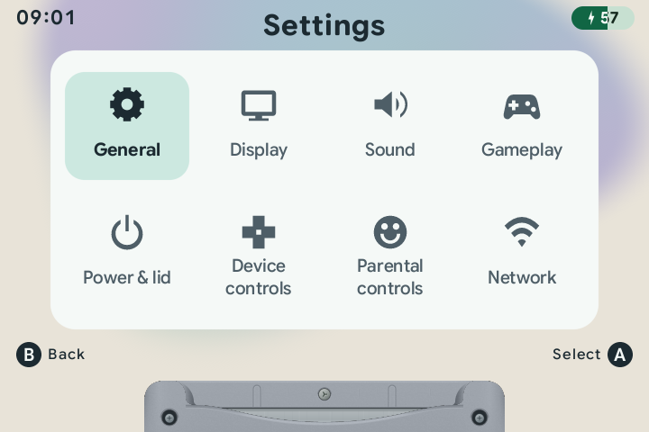
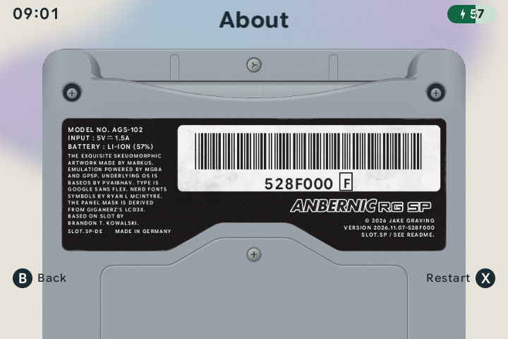

# Settings reference

Tap <kbd>MENU</kbd> on the carousel to open the settings grid. During a game, tap <kbd>MENU</kbd> and choose **Settings** to open the same settings grid. Changes save as you make them.

Use the D-pad to select a tile, <kbd>A</kbd> to open its card and <kbd>B</kbd> to return. Inside a card, Up/Down chooses a row; Left/Right changes its value. Right also opens a row marked with a single right-facing chevron, just like A. Follow the on-screen hints for editors and confirmations.

| Tile | Use it for | Instructions |
| :--- | :--- | :--- |
| **General** | Device code, Updates, Automatic time, Time zone, clock format, date/time and About. | [Clock & time](POWER-OPTIONS.md#set-the-clock) · [Device code](#device-code) |
| **Display & appearance** | Brightness, screen warmth, night schedules, UI theme, wallpaper, SP color, game names, carousel motion, Recents and Favorites order, plus screen effects, palettes and borders for each system. | [Screen](DISPLAY.md#screen-effects--borders) · [Day & night](NIGHT-DISPLAY.md) |
| **Sound** | Choose an audio output, pair headphones, set volume after a disconnect and optionally pause when audio disconnects, and toggle carousel sounds. | [Audio & headphones](BLUETOOTH.md) |
| **Gameplay** | Automatic resume and saving on exit, fast-forward speed and sound, rewind, turbo and rumble where supported. RetroAchievements is the first entry. | [Playing & saving](PLAYING.md) |
| **Power & lid** | Lid behavior, sleep, shutdown timer and startup animation. | [Sleep & power](POWER-OPTIONS.md) |
| **Device controls** | Game buttons, carousel buttons, shortcuts and the on-device reference. | [Buttons & shortcuts](CONTROLS.md) |
| **Parental controls** | Approved games, daily allowance, session timer or bedtime, maximum volume and either a separate parent code or the device code. | [Kid mode](KID-MODE.md) |
| **Network** | Connect and scan networks after setting and unlocking the Device code. | [Wi-Fi & achievements](RETROACHIEVEMENTS.md) |

## Device code

**Device code** is first in **General**. Choose a button sequence of six or more presses (Start finishes setup) or a keyboard passphrase of at least twelve characters. Credentials are always encrypted. Wi-Fi and RetroAchievements stay disabled without a code; existing shorter codes must be upgraded before network access. Six- and seven-button codes get a short warning because longer unpredictable secrets are stronger.

**Startup access** can require the code to use the launcher or allow games while
credentials stay locked. Skipping optional startup unlock shows “Saved credentials are locked.” The SD card and games remain accessible; only credentials are encrypted.
Parental controls can use this code or a separate four-button parent code.
See [Code setup, storage and reset](RETROACHIEVEMENTS.md#device-code-and-saved-credentials).

About is also under General; press <kbd>X</kbd> there to restart the launcher.

## During a game

Settings float over the game screen. Screen opens display settings for the current system; open **Display → Night mode** from the carousel to edit the automatic schedule. Tap <kbd>MENU</kbd> for **Resume**, **Settings** and **Exit game**. **Save states**, **Screenshots** and undo choices appear when available.

In kid mode, **Settings** opens four tiles: Sound, Screen, Buttons & shortcuts and Parental controls. See the [kid menu](KID-MODE.md#the-kid-menu).

## Light, dark, day and night

**Display → UI theme** changes the interface palette. **Display → Night mode** changes saved brightness and warmth settings, with an optional schedule. They are independent.

## Status icons and notices

The battery indicator shows the percentage. A lightning bolt inside it means the charger is connected. A slashed speaker means the active output is muted or its volume is zero. Bluetooth and headphones icons show the audio connection. The Wi-Fi icon appears alongside them while connected. A controller marks background RetroAchievements work. Yellow triangle pills warn about short codes. Wi-Fi and RetroAchievements require an encrypted vault and a code of at least six button presses (or a passphrase).

Connecting a charger briefly shows a charging notice and plays a tone. Short notices also report audio connections, setting changes and errors. An error includes a next step, such as waking the headphones and trying again.

The clock, status icons and button hints change between light and dark colors to stay readable over custom wallpapers. These color changes do not change your selected UI theme.

## About

**Updates** and **Automatic time** follow Device code in General. They are grey without a connected Wi-Fi network; selecting them opens Network with a short explanation. **Time zone** opens the UTC-offset field directly, works offline, and applies changes immediately. Automatic time corrects UTC in the background; choose your own local offset.

OTA compares exact source commits, so multiple releases on the same day are detected. For a diverged test build, a newer stable source can be offered using its source timestamp; an older stable source is not offered. A failed check asks you to retry.

## File sharing

On a trusted Wi-Fi network, open **Settings → Network → File sharing** and turn **Sharing** on. Choose **Set password** to enter 8–32 printable characters, or use the generated password. Select **Password** to show or hide it. Sign in with username **slot** and the sharing password.

- **macOS:** in Finder, choose **Go → Connect to Server** (⌘K) and enter the displayed `smb://` address.
- **Windows:** open **SLOTSP** in File Explorer’s Network view or enter `\\\\DEVICE-IP\\SDCard`.
- **Linux:** open the discovered server or enter `smb://DEVICE-IP/SDCard` in your file manager.

The **SDCard** share writes directly to the content card. Finish copying and turn sharing off before launching a game, opening Cart Studio, or installing an update. The carousel refreshes when sharing stops. Saving a new password disconnects existing sessions.

Sharing requires authenticated, encrypted SMB3. It turns **off after reboot by default**. **Keep on after reboot** can restore it after the Device code unlocks the vault and the saved network reconnects. Only share on a trusted network.

### Wi-Fi connection progress

The status-bar Wi-Fi icon pulses outward while connecting and getting an IP address, then stays steady once connected.

After Wi-Fi joins the router, **Getting an IP address…** keeps the progress
indicator active while DHCP finishes. This can take ten seconds or more. A
usable IPv4 address completes the connection; after 30 seconds without one,
slot shows **No IP address · retry**. A late address
still recovers automatically. Updates stay unavailable until the address arrives.

If a connection repeatedly fails, press **L + R** together on the Network page to save an offline Wi-Fi report. The notification shows the filename in the SD card’s **Diagnostics** folder. The report leaves out network names, addresses, passwords, and account tokens.
